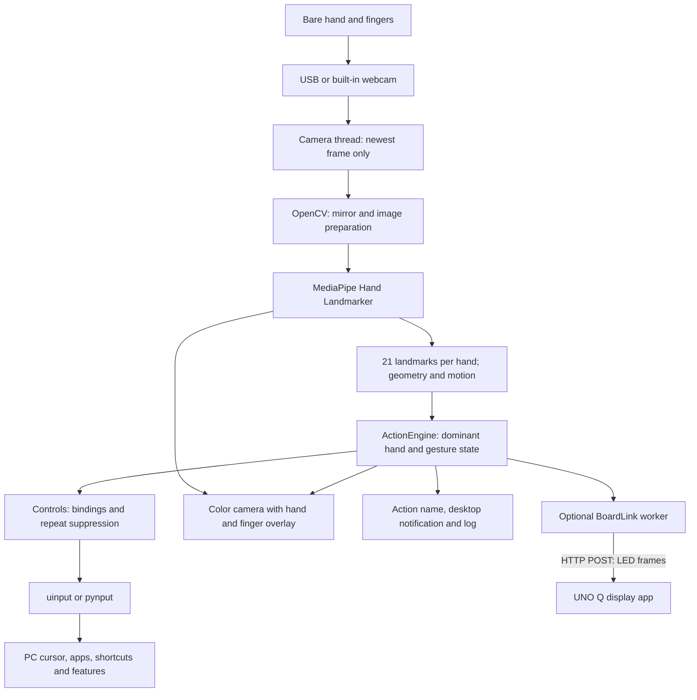
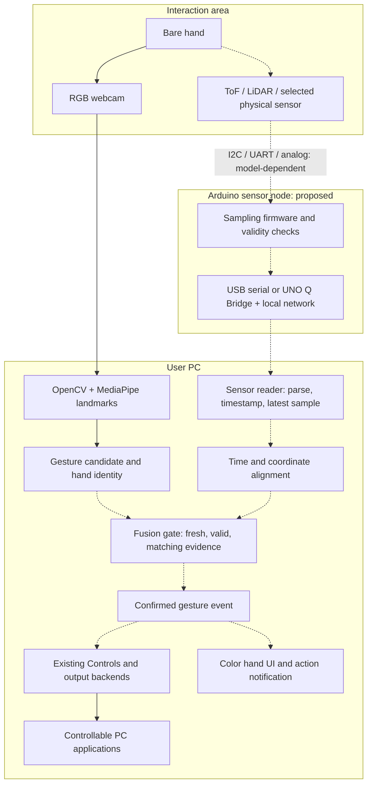
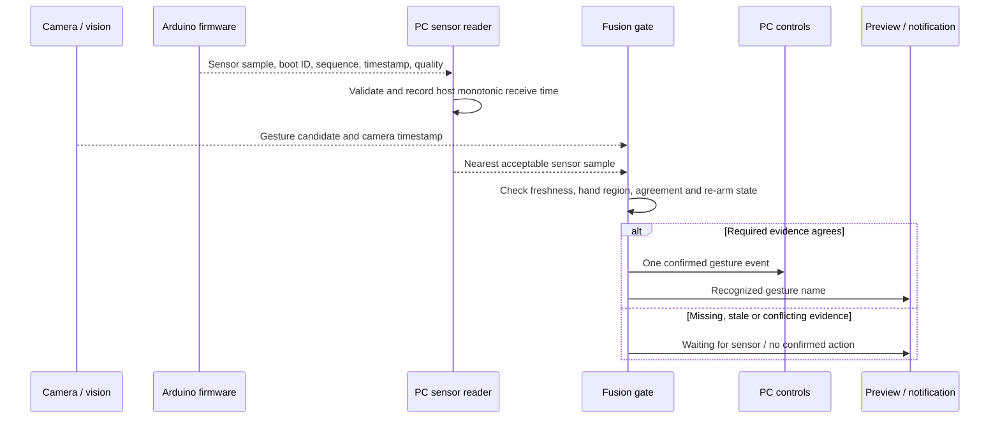
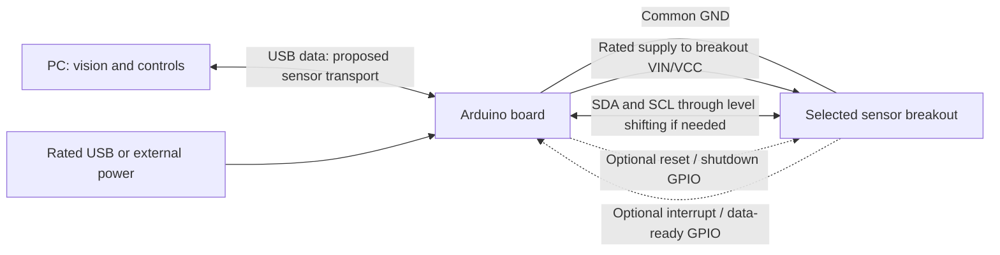
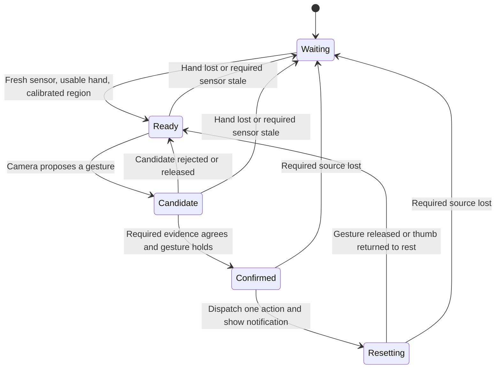
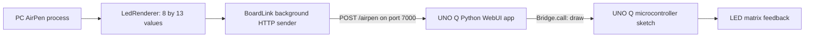

# AirPen — bare-hand gesture control with OpenCV and Arduino sensors

Control PC applications with your fingers and hand gestures. **No pen or stylus is required.**
“AirPen” is the existing project/package name; the active runtime recognizes a bare hand.

The intended system combines two inputs:

- **Camera + OpenCV + MediaPipe:** find the hand, track individual fingers, and recognize gestures.
- **Arduino + distance/ToF/LiDAR or other sensors:** measure physical signals that help decide
  whether a hand is present, in the interaction area, and moving as expected.

The PC combines that evidence, confirms a gesture, and maps it to a click, shortcut, workspace,
media control, or application launcher. The preview stays a normal color camera image with
hand/finger tracking overlays and action notifications.

> **Implementation status:** camera-based control works in this repository, with known recognition
> limitations. Arduino sensor ingestion and camera/sensor fusion are **planned, not implemented**.
> The existing UNO Q integration sends PC status **to the board's LED display**; it does not send
> sensor measurements back to the PC. Connecting a LiDAR sensor will not enable fusion yet.

## Contents

1. [What works today](#1-what-works-today)
2. [System architecture](#2-system-architecture)
3. [Hardware and infrastructure](#3-hardware-and-infrastructure)
4. [Install and run the current application](#4-install-and-run-the-current-application)
5. [Gestures and PC controls](#5-gestures-and-pc-controls)
6. [Calibration, recording, and validation](#6-calibration-recording-and-validation)
7. [Arduino and sensor wiring](#7-arduino-and-sensor-wiring)
8. [Proposed sensor protocol and fusion](#8-proposed-sensor-protocol-and-fusion)
9. [Existing UNO Q display integration](#9-existing-uno-q-display-integration)
10. [Implementation roadmap](#10-implementation-roadmap)
11. [Operations and troubleshooting](#11-operations-and-troubleshooting)
12. [Repository map and references](#12-repository-map-and-references)

## 1. What works today

| Capability | Status | Implementation |
|---|---|---|
| Webcam capture, mirrored color preview | Implemented | `airpen/tracker.py`, `airpen/main.py` |
| Hand landmarks and finger geometry | Implemented | MediaPipe through `HandTracker`; shared metrics in `airpen/gestures.py` |
| Dominant-hand selection | Implemented | `airpen/settings.py`, `ActionEngine` |
| Seven discrete gesture events | Implemented; accuracy needs validation | `airpen/actions.py` |
| Hand/finger UI and recognized-action messages | Implemented | `CameraOverlay` in `airpen/fx.py` |
| Desktop notifications | Implemented when `notify-send` is available | `Notifier` in `airpen/main.py` |
| Mouse, shortcuts, workspaces, media, launchers | Implemented; desktop permissions apply | `airpen/controls.py`, `airpen/output.py` |
| Personal calibration and landmark replay | Implemented | `airpen/calibrate.py`, `airpen/record.py`, `airpen/replay.py` |
| PC-to-UNO Q LED feedback | Implemented in code; physical hardware unverified | `airpen/unoq.py`, `unoq_app/` |
| Arduino-to-PC distance or other sensor input | **Not implemented** | Needs firmware and a PC sensor adapter |
| Camera/sensor timestamp alignment and fusion | **Not implemented** | Needs synchronization, spatial calibration, and a fusion gate |
| LiDAR-only individual finger recognition | **Not implemented** | Requires suitable sensor resolution and a separately validated model |

The saved real-hand recordings still include missed gestures and false activations, especially
left thumb swipes. Passing synthetic tests is not an accuracy guarantee. See [AUDIT.md](AUDIT.md).
Sensor fusion is a proposed way to add evidence; it does not automatically solve finger occlusion
or a weak gesture classifier.

`airpen/pen.py` and older pen/mouse logic are legacy code. The active entry point is
`airpen.main` → `ActionEngine` → `Controls`; it does not require holding or detecting a pen.

## 2. System architecture

### Current, runnable architecture

Solid arrows below represent connections present in the code.



OpenCV handles camera images and drawing. **MediaPipe supplies the hand-landmark model.**
Gesture recognition uses geometry, temporal confirmation, smoothing, and state transitions;
it is not a separately trained LiDAR or sensor-fusion model. MediaPipe's inferred 3D landmarks
and the application's camera-distance estimate are model-derived estimates, not physical
measurements from a depth sensor.

### Intended camera + Arduino sensor architecture

**All dashed connections and the sensor/fusion components are proposed work.** The camera and
PC-control path remain the existing foundation.



**Responsibility split:** the camera identifies fingers; the Arduino measures its attached sensors;
the PC owns the final gesture decision and dispatches each action once. Keep vision and native
PC control on the PC for the first implementation. Moving inference onto a board would be a
separate deployment, not something `--unoq` enables.

### Proposed event sequence



This sequence is a **design contract**, not the behavior of a sensor reader that already exists.

## 3. Hardware and infrastructure

### Hardware checklist

| Item | Camera-only operation | Proposed sensor-assisted operation |
|---|---|---|
| Linux PC with a desktop session | Required | Required; owns PC input and gesture decisions |
| Webcam | Required | Required for this design's individual finger tracking |
| Arduino board | Not required | Required for the Arduino sensor path; exact model must be confirmed |
| USB data cable | For an external camera | Also connects/powers the board where supported; a charge-only cable is insufficient for data |
| Distance/ToF/LiDAR breakout | Not required | Required if distance evidence is desired; exact part and breakout must be confirmed |
| Jumper wires, mounting bracket, suitable power | Camera mounting | Also keep the sensor stable and its interaction area overlapping the camera view |
| Level shifting / breakout regulation | Not required | Depends on the exact board and sensor's electrical interfaces |
| LAN or Wi-Fi | Not required | Only for network-connected board paths, including the existing UNO Q display |
| Pen, stylus, cloud account, cloud GPU | Not required | Not required |

Start with the existing camera path, then add one sensor stream. Do not buy a particular board
or sensor based on the repository name: board pinout, RAM/flash, driver compatibility, interface,
and breakout voltage handling must match the actual parts.

### What different sensors can contribute

| Sensor/input | Useful evidence | Limit |
|---|---|---|
| Single-zone ToF/range measurement | Hand entered a distance band; approach/withdraw motion | One range value does not identify which finger moved |
| Multizone ToF depth grid | Coarse occupied region, depth movement, direction corroboration | A low-resolution grid is not a full finger skeleton |
| Higher-resolution depth camera | Depth registered with camera observations | Needs its own SDK, alignment, and validation; no driver exists here |
| Touch/capacitive input or a physical button | Explicit activation or confirmation | Measures contact/activation, not a complete hand pose |
| IMU | Board/wearable orientation and acceleration | A stationary desk-mounted IMU does not measure individual finger bending |
| Finger-mounted flex/contact sensors | Direct per-finger signals when instrumented | Requires wearable hardware, calibration, and input adapters not present here |

For example, ST's VL53L1X provides ranging with a configurable region of interest; its existence
does not imply finger identities. ST's VL53L5CX provides 4×4 or 8×8 zones. Its documented maximum
rates depend on resolution: 60 Hz at 4×4 and 15 Hz at 8×8. These are device capabilities, not
measured AirPen performance. See the [VL53L1X product documentation](https://www.st.com/en/imaging-and-photonics-solutions/vl53l1x.html)
and [ST's resolution/rate specifications](https://www.st.com/resource/en/flyer/vl53l5cx_flyer.pdf).

**Proposed first sensor role:** use distance or coarse depth to confirm an occupied interaction
region. Continue to derive index, middle, ring, pinky, and thumb positions from the camera.
Proving that a depth sensor can distinguish fingers is a separate experiment.

### Runtime infrastructure

| Layer | Current requirement | Added for sensor fusion |
|---|---|---|
| Operating system | Linux desktop; launcher uses POSIX signals, `fcntl`, and `/proc` | Board serial-device access, or the chosen local network transport |
| Python | Python 3.12 is the launcher's environment target | Sensor adapter library, such as `pyserial`, if serial is selected; not currently a dependency |
| Vision libraries | `opencv-contrib-python`, `mediapipe`, `numpy`, `pillow` | No replacement of this pipeline required for a first proximity gate |
| Input backend | `evdev`/uinput on Linux; `pynput` fallback where supported | Existing backend remains the final PC action executor |
| Desktop UI | Working OpenCV GUI/display session for preview | Sensor status should appear beside tracking status; proposed |
| Notifications | `notify-send` for desktop popups; on-screen messages work without it | Existing notifications should describe confirmed events |
| Model | `models/hand_landmarker.task` | Any new model/firmware assets must be supplied by the sensor implementation |
| Network services | None for camera-only operation | None for a serial design; UNO Q display uses local HTTP port 7000 |
| Database, broker, containers | Not required | Not needed for the initial local fusion design |

A hardware GPU is not required by the current application. Achievable frame rate and latency
must be measured on the actual PC; there is no published minimum CPU/RAM benchmark here.
After dependencies and the model are downloaded, the camera runtime does not need cloud inference.

## 4. Install and run the current application

Run commands from the repository root. Install Git, Bash, `curl`, and
[uv using its official installation instructions](https://docs.astral.sh/uv/getting-started/installation/).
The launch script also uses standard Linux utilities such as `setsid`.

Optional system tools are `v4l2-ctl` for camera controls, `notify-send` for desktop notifications,
and `hyprctl` when using Hyprland workspace integration. Install them through your distribution's
package manager. OpenCV preview also needs the display libraries required by its installed wheel.

### First run: recognize gestures without sending PC input

```sh
./run.sh fg --backend none
```

On the first run, `run.sh` creates `.venv` using Python 3.12, installs `requirements.txt`, and
downloads the MediaPipe model if it is missing. Downloading/installing requires internet access.
If `.venv` already exists, the launcher does not automatically refresh its dependencies; update
those explicitly when `requirements.txt` changes:

```sh
uv pip install --python .venv/bin/python -r requirements.txt
```

The preview should show the **normal color camera**, hand skeletons, colored finger joints,
fingertip highlights, and dominant/ignored hand labels. Recognized gestures appear by name for
two seconds. `--backend none` prevents input injection and program-launch bindings, but still
allows recognition, logging, and notifications.

### Commands

| Command | Behavior |
|---|---|
| `./run.sh` | Start the background service if necessary and open the preview |
| `./run.sh start` | Start in the background without opening the preview |
| `./run.sh fg --backend auto` | Foreground run with preview and automatic PC output selection |
| `./run.sh fg --backend none` | Foreground recognition-only run |
| `./run.sh show` | Toggle the running service's preview |
| `./run.sh status` | Show process status and recent log entries |
| `./run.sh stop` | Request service shutdown |
| `./run.sh hand` | Print the selected dominant hand |
| `./run.sh hand left` / `./run.sh hand right` | Save the dominant hand; restart to apply |
| `./run.sh calibrate` | Run personal hand-shape calibration with the service stopped |
| `./run.sh record` | Guided landmark recording; leaves the service stopped afterward |
| `./run.sh replay` | Check the newest recording against expected gesture counts |

Closing the preview, pressing `q`, or pressing Escape **hides the window**; it does not stop
background recognition or PC control. Use `./run.sh stop`, or Ctrl+C in a foreground run.

Stop an existing background process before starting a foreground run:

```sh
./run.sh stop
./run.sh fg --backend none --camera 0 --width 640 --height 480 --fps 30
```

The stop command requests termination; if the foreground command reports “already running”,
wait for shutdown and retry. Only one AirPen instance may hold the runtime lock.
`--camera` accepts a camera number or device path. `--dynamic-fps` lets the camera manage its
low-light frame rate. `--no-notify` disables desktop popups, not the in-preview action message.

### PC output permissions

`--backend auto` tries Linux uinput first. It requires the desktop user to have access to
`/dev/uinput`. Check the device and configure access using your distribution's device policy:

```sh
ls -l /dev/uinput
```

On native Wayland, automatic fallback becomes recognition-only if uinput is unavailable; it
will not silently promise full desktop control through XWayland. On X11, `pynput` can be the
fallback. Explicit `--backend uinput` or `--backend pynput` fails if that backend cannot initialize.
The existence of a portable `pynput` library does not make the Linux launcher Windows/macOS compatible.

## 5. Gestures and PC controls

The active recognizer watches your saved dominant hand; the other hand is drawn but ignored.

| ID | Gesture | Physical action | Default PC binding |
|---|---|---|---|
| 1 | `index_tap` | Touch thumb and index fingertip; keep the ring finger extended | Left click |
| 2 | `middle_tap` | Touch thumb and middle fingertip; keep the ring finger extended | Right click |
| 3 | `fist` | Close all four fingers and hold briefly | Toggle hand-controlled cursor |
| 4 | `thumb_swipe_right` | In a latched fist, swipe the thumb right | Next workspace |
| 5 | `thumb_swipe_left` | In a latched fist, swipe the thumb left | Previous workspace |
| 6 | `peace` | Index and middle fingers separated in a V; other fingers folded | Pause/resume controls |
| 7 | `thumb_tap` | In a latched fist, lift and return the thumb | Media play/pause |

For thumb swipes, settle the thumb briefly, perform one stroke, and return to the starting
position before repeating. Return movement is a reset, not a second action. Opening the hand
also resets the thumb state. The old `thumb_return_block_s` tuning field was replaced by
position-based return handling using `thumb_return_range`.

Fist has two roles: cursor toggle and prerequisite for thumb gestures. Set its binding to
`none` if you want workspace/shortcut gestures without toggling the cursor. Cursor movement
uses an adaptive hand anchor and freezes during fist controls and tap formation. Clicks are
discrete; this seven-action path does not implement pinch-to-drag.

### Custom shortcuts and application launchers

```sh
mkdir -p "${XDG_CONFIG_HOME:-$HOME/.config}/airpen"
cp config/bindings.example.json "${XDG_CONFIG_HOME:-$HOME/.config}/airpen/bindings.json"
```

Edit that file, then restart AirPen. For example:

```json
{
  "fist": {"type": "none"},
  "thumb_tap": {"type": "hotkey", "keys": ["ctrl", "l"]},
  "thumb_swipe_right": {"type": "scroll", "amount": -120},
  "thumb_swipe_left": {"type": "command", "argv": ["gtk-launch", "firefox"]}
}
```

Use an application launcher actually installed on your machine; `gtk-launch firefox` is an
example, not a bundled program. `ctrl+l` commonly focuses a browser's address bar.

Binding types are `none`, `click`, `workspace`, `scroll`, `hotkey`, `command`, `toggle_pointer`,
and `toggle_enabled`. Scroll amounts use 120 units per wheel notch. Supported named keys include
`ctrl`, `shift`, `alt`, `super`, arrows, `space`, `enter`, `esc`, `tab`, `backspace`, `play_pause`,
`volume_up`, `volume_down`, and `mute`; ASCII letters and digits are also supported.

Omitted gestures retain defaults. Preserve a `toggle_enabled` binding if you want a gesture
that pauses control. `--bindings /path/to/bindings.json` selects another file. Malformed bindings
stop startup before the camera and input devices are opened.

Commands use argument arrays without a shell. One worker runs them with a four-command pending
queue and a three-second execution timeout; use a launcher that returns promptly. A long-running
command is terminated. Pausing invalidates queued commands; a command already started may finish.

A **recognized-action notification confirms recognition**, not that an external application
successfully performed a shortcut or launch. Check the configured binding, backend, and log
when an action is recognized but the PC does not respond.

## 6. Calibration, recording, and validation

### Camera-only calibration available now

```sh
./run.sh hand right
./run.sh calibrate
./run.sh record --reps 5
./run.sh replay
```

Calibration records several poses and fits hand-shape/tap thresholds. It is not a calibration
of Arduino sensors and does not train a sensor-fusion model. `calibrate` may restart a previously
running service afterward; `record` deliberately leaves it stopped.

Recording saves raw landmarks, presence flags, timestamps, and metadata under
`captures/<timestamp>/`. It does not save a raw camera video. Missing-hand samples are retained
so replay can exercise tracking loss. A normal recording has neutral/open-hand checks and gesture
steps; keep complete release/reset movements between repetitions.

```sh
./run.sh record --hand left --reps 8
# Replace <timestamp> with an actual recording directory name.
./run.sh replay "captures/<timestamp>"
.venv/bin/python -m airpen.replay "captures/<timestamp>" --tol 0
.venv/bin/python -m airpen.calibrate --refit
```

Default replay allows a difference of one event from each expected count. Unexpected events
fail a step except extra fist events, which are reported separately. `--tol 0` removes count
tolerance. Saved thresholds are compared with the current thresholds to explain changed results.
Count targets are not event-level labels: they cannot establish precision, recall, or latency alone.

```sh
.venv/bin/python -m pytest -q
```

Tests cover synthetic gestures, hand loss, swipe returns, PC dispatch, configuration, and color
UI behavior. Real-camera evaluation remains necessary; the saved left-swipe sample still fails.

### Additional calibration needed for sensor fusion — planned

1. Measure sensor behavior with no hand, a still hand, and approach/withdraw motion.
2. Define the useful distance band and reject invalid sensor targets instead of treating them as zero distance.
3. Mount the camera and range sensor rigidly with overlapping interaction areas.
4. Map depth-grid zones into the camera's interaction region, including any lens/zone orientation and selfie mirroring.
5. Align host/camera time with board acquisition time; record transport delay and uncertainty.
6. Record synchronized vision and sensor samples with **per-event times**, including non-gestures and return strokes.
7. Compare camera-only and fused decisions on separate sessions before enabling fused PC controls.

ST documents a reversed scene/zone orientation for the VL53L5CX optical arrangement. Do not
assume zone zero corresponds to the top-left of the mirrored preview; verify the installed
orientation. See the [sensor orientation and driver manual](https://www.st.com/resource/en/user_manual/um2884-a-guide-to-using-the-vl53l5cx-multizone-timeofflight-ranging-sensor-with-wide-field-of-view-ultra-lite-driver-uld-stmicroelectronics.pdf).

## 7. Arduino and sensor wiring

**This is a logical connection plan, not a pin-specific wiring instruction.** The exact Arduino
model and sensor breakout are not specified. Confirm their pinouts, supply ratings, I/O levels,
and driver support before making the physical connection.



| Connection | What must be established |
|---|---|
| Supply | Breakout input rating, regulator presence, and board power budget |
| Ground | Shared reference for the board and attached sensor |
| I²C | Board SDA/SCL pins, logic levels, pull-ups, driver address convention, and bus speed |
| UART alternative | Sensor TX/RX levels and framing; cross TX to RX only as specified by the devices |
| Analog alternative | Sensor output range and board ADC input limits |
| Interrupt/reset | Exact pin behavior and required firmware support |
| Host link | USB data support, serial endpoint or network interface, and required PC permissions |

An “Arduino-compatible” label does not establish voltage compatibility. A breakout may contain
regulation/level shifting that the bare sensor does not. A multizone driver can also have firmware
and memory requirements that a small board cannot satisfy. Check the exact module and driver.

For **UNO Q**, the Linux processor and microcontroller communicate using Arduino Bridge.
A proposed sensor path is MCU acquisition → Bridge → Linux-side sensor adapter → PC. Do not assume
it behaves like an AVR board's USB serial sketch. Arduino documents the dual-processor structure
and Bridge in the [UNO Q hardware documentation](https://docs.arduino.cc/hardware/uno-q/) and
[UNO Q user manual](https://docs.arduino.cc/tutorials/uno-q/user-manual/).

## 8. Proposed sensor protocol and fusion

Nothing in this section is currently parsed by AirPen. There is no working `--sensor-port`,
`--lidar`, or sensor configuration file yet.

### Board-to-PC data contract

For a first serial implementation, use versioned newline-delimited JSON: one complete compact
object per line. Keep debug text on a different channel so it cannot masquerade as a sample.
Example **proposed** 4×4 sample:

```json
{
  "v": 1,
  "source": "desk-tof",
  "boot_id": "boot-0042",
  "seq": 218,
  "sensor_time_us": 7352000,
  "kind": "tof_grid",
  "rows": 4,
  "cols": 4,
  "distance_mm": [420, 415, 410, 430, 405, 300, 295, 412, 409, 302, 298, 418, 425, 416, 420, 435],
  "valid": [true, true, true, true, true, true, true, true, true, true, true, true, true, true, true, true]
}
```

The example is pretty-printed for reading; the wire version must occupy **one line**. It is a
schema illustration, not data from attached hardware. `valid` is the firmware adapter's normalized
validity flag after interpreting the selected sensor's raw status codes. Arrays are row-major
and must contain exactly `rows × cols` entries. Version the mapping if orientation changes.

The future PC reader must:

- Bound packet length and parsing time, validate schema/types/ranges, and reject incomplete frames.
- Reject duplicates/out-of-order sequence numbers within one `source`/`boot_id` stream.
- Treat a new boot ID or clock reset as a new stream; discard old alignment/history and handle hardware timer rollover.
- Record `host_receive_monotonic_ns` separately from board acquisition time.
- Estimate clock offset/drift and transport uncertainty; never directly compare MCU ticks with PC timestamps.
- Retain a bounded time buffer for alignment and expose a latest-sample view; never accumulate an unbounded backlog.
- Reconnect without blocking camera capture or replaying stale measurements as fresh gestures.

**Transport budget example, not a measured result:** an asynchronous 115200-baud UART using
8N1 framing carries about 11,520 payload bytes/s before higher-level overhead. At 600 encoded
bytes/sample and 15 samples/s, a stream consumes 9,000 bytes/s. A 1,024-byte sample at that rate
would exceed this UART budget. Measure the actual encoding; use a supported higher baud rate,
a smaller payload, or binary framing if necessary. USB CDC and UNO Q network paths have different
throughput behavior and must be measured independently.

### Fusion policy

Start with a **gate**, not an unvalidated numeric “accuracy score.” The camera proposes the
finger gesture. Sensor measurements can confirm a matching occupied region or depth movement.
A scalar range measurement must not independently emit an index/middle/peace gesture.

Two explicit modes should eventually exist:

| Proposed mode | Missing/stale sensor behavior |
|---|---|
| `camera_only` | Continue the current vision path; make the mode visible |
| `sensor_required` | Suppress PC input, including cursor updates, until fresh valid required evidence returns |

Do not silently fall back from `sensor_required` to camera-only control. An optional physical
activation button can be added later as an explicit input, not inferred from an arbitrary signal.

Starting experimental targets could be a 30 fps camera, a sensor rate supported by its selected
resolution, a 200 ms sensor-stale deadline, and a 100 ms maximum aligned sample skew. These are
**initial engineering assumptions to measure and tune**, not implemented options or guaranteed
latency. Acquisition timestamps, sensor integration duration, and transport jitter must all be
considered; receipt time alone is not sufficient synchronization.



This state machine is proposed. One PC-side state owner should assign unique confirmed-event IDs
(separate from the current 1–7 gesture-class IDs) and perform repeat suppression. The camera
and Arduino must not independently execute the same action. On source loss, cancel pending
candidates and release held input; after reconnect or process restart, do not replay old PC actions.
An action dispatch attempt is not an exactly-once guarantee from the external desktop application.

## 9. Existing UNO Q display integration

This is the **current output-only accessory path**:



The UNO Q application uses `arduino:web_ui` in `unoq_app/app.yaml`. Its Python side accepts
104 brightness values; the sketch exposes a Bridge `draw` function and updates the matrix.
The PC sender is isolated from the vision loop and sends recent display state with a network timeout.

Use Arduino App Lab to open and run `unoq_app/` on a compatible UNO Q. Hardware deployment and
the required App Lab/board library versions have not been validated here. Once the app is running
and reachable on the local network:

```sh
# Replace BOARD_IP with the board's actual address.
./run.sh fg --backend none --unoq BOARD_IP
curl "http://BOARD_IP:7000/airpen/status"
```

The board's HTTP API is a local prototype without application-level authentication. It does
not need internet exposure. It returns display-link status, not finger recognition or LiDAR data.

You can exercise only the PC-to-board display transport without physical hardware using two terminals:

```sh
# Terminal 1: simulated LED receiver, not a sensor simulator.
.venv/bin/python tools/fake_unoq.py
```

```sh
# Terminal 2: normal camera recognition with simulated LED output.
./run.sh fg --backend none --unoq localhost
```

## 10. Implementation roadmap

This is the missing work needed to turn the sensor-assisted architecture into a runnable system.
The paths below are proposed additions, not files that already exist.

| Stage | Work | Completion evidence |
|---|---|---|
| 1. Identify hardware | Record exact board, sensor/breakout, wiring, power and driver versions | Confirmed pin/interface table and standalone valid readings |
| 2. Firmware acquisition | Add sensor firmware, sampling, timestamps, sequence/boot IDs and validity | Continuous bounded stream survives sensor errors and board reset |
| 3. PC transport | Add an adapter such as `airpen/sensors/serial_reader.py`; UNO Q needs its selected Bridge/network path | Reader reconnects, rejects malformed/stale samples, and never stalls vision |
| 4. Time/spatial alignment | Add aligned sample buffers and camera/sensor region calibration | Known hand motion matches both streams with measured skew |
| 5. Fusion gate | Add a component such as `airpen/fusion.py` between candidate recognition and action dispatch | Required-source failures suppress actions and reconnects create no phantom events |
| 6. Synchronized recording | Extend capture/replay to include raw sensor samples, status, timing and event labels | A saved session deterministically reproduces fused decisions |
| 7. Evaluation | Test gestures and ordinary motion in independent sessions | Measured false activations, misses and end-to-end latency support enabling controls |

The current `ActionEngine.update()` emits events directly. A first integration can gate those
candidates **before `Controls.update()` dispatches them**, but must gate continuous cursor output
too, preserve release/re-arm state, and ensure the UI distinguishes a candidate from a confirmed action. A deeper integration may
expose an explicit candidate API. Neither change exists yet.

## 11. Operations and troubleshooting

### Local files and runtime state

| Path | Purpose |
|---|---|
| `.venv/` | Python environment |
| `models/hand_landmarker.task` | Downloaded landmark model |
| `${XDG_CONFIG_HOME:-~/.config}/airpen/settings.json` | Dominant hand |
| `${XDG_CONFIG_HOME:-~/.config}/airpen/tuning.json` | Personal thresholds |
| `${XDG_CONFIG_HOME:-~/.config}/airpen/bindings.json` | Gesture-to-control mapping |
| `${XDG_CONFIG_HOME:-~/.config}/airpen/calibration_samples.json` | Saved calibration measurements |
| `captures/<timestamp>/` | Landmark recordings and metadata |
| `${XDG_STATE_HOME:-~/.local/state}/airpen.log` | Background service log |
| `${XDG_RUNTIME_DIR:-/tmp}/airpen.pid` | Process ID and instance lock |

These path expressions describe defaults; use the actual environment variable values when set.
The current recordings contain landmarks, not uploaded video. Network traffic is optional and
limited to the board endpoint when `--unoq` is enabled. Adding sensor networking would introduce
a separate data path that must be documented when implemented.

For Hyprland login startup, add an entry using your real absolute repository path:

```ini
exec-once = "/absolute/path/to/Design-Project-I/run.sh" start
```

Enable automatic PC control only after validating the bindings and recognition on your setup.
There is no installed system service, Docker deployment, or cloud infrastructure to provision.

### Troubleshooting table

| Symptom | Check |
|---|---|
| Camera never opens | Camera index/device, another process holding it, device permissions, USB connection; the runtime retries opening |
| “Already running” | Use `./run.sh status` and stop the existing instance before a foreground run |
| No preview but process is running | `./run.sh show`; verify a desktop display session is available |
| Closing preview did not stop controls | Expected: stop the service explicitly |
| Recognition message appears but no PC effect | Check `--backend`, uinput permissions, pause state and the gesture's binding |
| No desktop popup | Check `notify-send` and `--no-notify`; in-preview action messages remain available |
| Hand is labeled ignored | Set the correct dominant hand and restart |
| Taps or thumb swipes are missed | Use calibration and replay; keep release/reset movements clear; real left-swipe accuracy remains unresolved |
| Fist unexpectedly toggles cursor | Fist is the default cursor-toggle binding; remap it to `none` if unwanted |
| Dependency or `cv2` import errors | Refresh requirements; avoid installing both OpenCV distributions into the same environment |
| Arduino connected but nothing changes in recognition | Expected today: sensor ingestion/fusion is not implemented |
| UNO Q shows an idle animation | Verify the display app, board address, local network and `/airpen/status` |
| A future sensor feed becomes stale | In proposed `sensor_required` mode, suppress actions and show source status until fresh evidence returns |

## 12. Repository map and references

```text
Design-Project-I/
├── airpen/
│   ├── main.py          # Runtime, signals, preview and notifications
│   ├── tracker.py       # Camera capture and MediaPipe landmarks
│   ├── gestures.py      # Shared geometry/tuning plus older gesture logic
│   ├── actions.py       # Active seven-action recognizer
│   ├── controls.py      # Validated bindings and action dispatch
│   ├── output.py        # Native input backends and shortcuts
│   ├── pointer.py       # Cursor filtering and mapping
│   ├── fx.py            # Color CameraOverlay; legacy monochrome HandFX remains here
│   ├── ui.py            # Drawing and guided-capture helpers
│   ├── calibrate.py     # Personal camera-gesture calibration
│   ├── record.py        # Guided raw landmark capture
│   ├── replay.py        # Offline expected-count evaluation
│   ├── settings.py      # Dominant-hand settings
│   ├── tuning_io.py     # Configuration validation
│   ├── unoq.py          # PC-to-UNO Q display sender
│   ├── ledframe.py      # LED display frame generation
│   └── pen.py           # Legacy pen detector; not used by the active runtime
├── config/bindings.example.json
├── unoq_app/            # Existing UNO Q display app, not sensor firmware
│   ├── app.yaml
│   ├── python/main.py
│   └── sketch/sketch.ino
├── tools/fake_unoq.py   # Simulated LED receiver
├── tests/               # Geometry, recognition, UI and runtime tests
├── models/              # Downloaded model; ignored by Git
├── captures/            # Local recordings; ignored by Git
├── requirements.txt
├── run.sh
└── AUDIT.md             # Verified findings and remaining limitations
```

Authoritative hardware/setup references:

- [Arduino UNO Q hardware and Bridge overview](https://docs.arduino.cc/hardware/uno-q/).
- [Arduino UNO Q user manual and App Lab setup](https://docs.arduino.cc/tutorials/uno-q/user-manual/).
- [ST VL53L5CX datasheet](https://www.st.com/resource/en/datasheet/vl53l5cx.pdf).
- [ST VL53L5CX driver, timing and zone-orientation manual](https://www.st.com/resource/en/user_manual/um2884-a-guide-to-using-the-vl53l5cx-multizone-timeofflight-ranging-sensor-with-wide-field-of-view-ultra-lite-driver-uld-stmicroelectronics.pdf).
- [ST VL53L1X ranging sensor documentation](https://www.st.com/en/imaging-and-photonics-solutions/vl53l1x.html).
- [uv installation](https://docs.astral.sh/uv/getting-started/installation/).

The diagrams are Mermaid blocks intended for a Markdown viewer that supports Mermaid. Their
source remains readable in plain text. All sensor-side components marked proposed need to be
implemented and tested against the exact Arduino and sensor hardware before they can control the PC.
